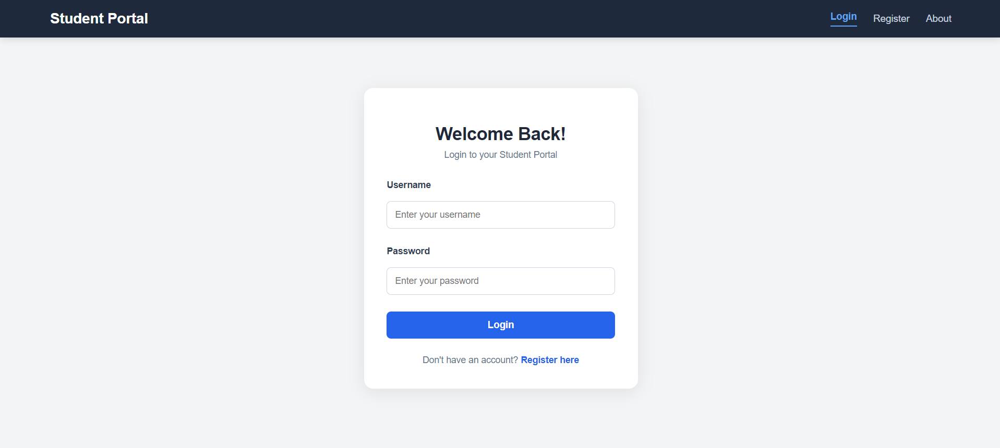
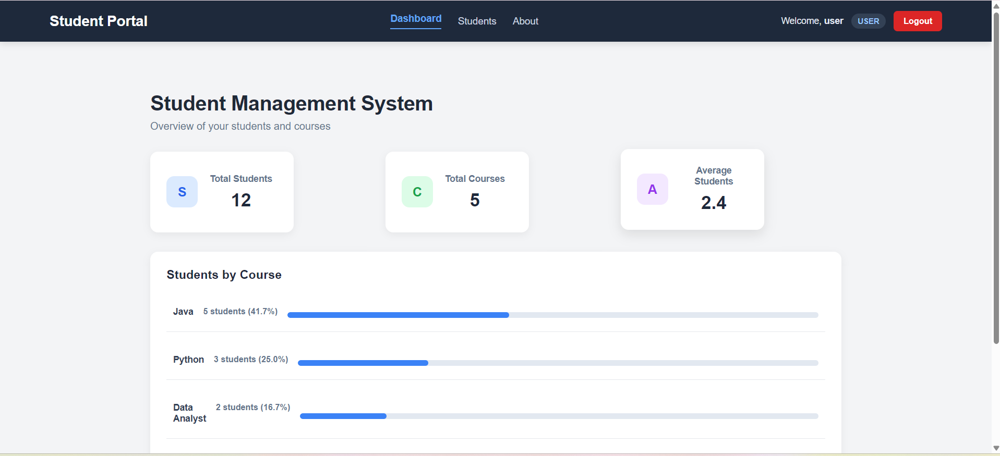
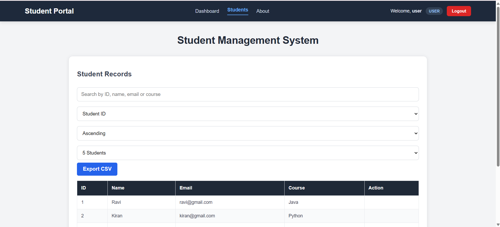
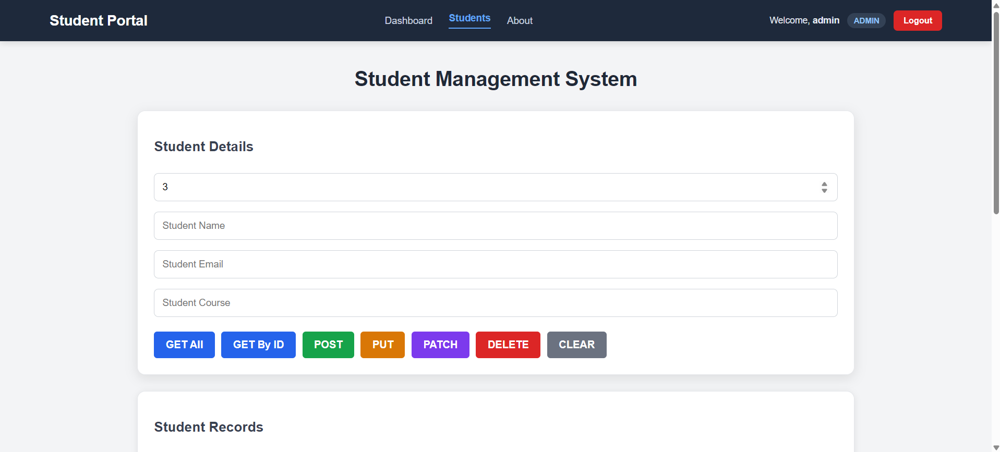
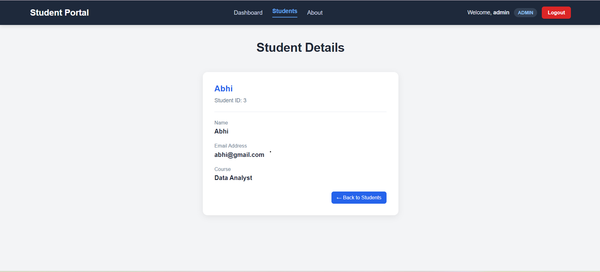

# React + Vite

This template provides a minimal setup to get React working in Vite with HMR and some Oxlint rules.

Currently, two official plugins are available:

- [@vitejs/plugin-react](https://github.com/vitejs/vite-plugin-react/blob/main/packages/plugin-react) uses [Oxc](https://oxc.rs)
- [@vitejs/plugin-react-swc](https://github.com/vitejs/vite-plugin-react/blob/main/packages/plugin-react-swc) uses [SWC](https://swc.rs/)

## React Compiler

The React Compiler is not enabled on this template because of its impact on dev & build performances. To add it, see [this documentation](https://react.dev/learn/react-compiler/installation).

## Expanding the Oxlint configuration

If you are developing a production application, we recommend using TypeScript with type-aware lint rules enabled. Check out the [TS template](https://github.com/vitejs/vite/tree/main/packages/create-vite/template-react-ts) for information on how to integrate TypeScript and Oxlint's TypeScript related rules in your project.


# Student Management System

A full-stack Student Management System built using **React, Spring Boot, Spring Security, JWT Authentication, and MySQL**.

The application provides secure student record management with role-based access control for ADMIN and USER accounts.

## Live Demo

- **Frontend:** https://student-management-frontend-two-swart.vercel.app
- **Backend API:** https://student-management-backend-production-8c7e.up.railway.app
- **Swagger API Documentation:** https://student-management-backend-production-8c7e.up.railway.app/swagger-ui/index.html

- ## Screenshots

### Login Page


### Dashboard


### Students Page for User


### Students Page for Admin


### Student Details


## Technologies Used

### Frontend
- React
- JavaScript
- HTML5
- CSS3
- Vite
- React Router

### Backend
- Java 21
- Spring Boot
- Spring Security
- Spring Data JPA
- Hibernate
- JWT Authentication
- BCrypt Password Encryption
- REST APIs
- Maven

### Database and Deployment
- MySQL
- Git and GitHub
- Railway – Backend and Database Hosting
- Vercel – Frontend Hosting

## Features

### Authentication and Authorization
- User registration and login.
- JWT-based authentication.
- Password encryption using BCrypt.
- Role-based access control (ADMIN and USER).
- Secure API endpoints.

### Student Management
- Add new student records.
- View all students.
- View individual student details.
- Update student information.
- Partially update student records.
- Delete student records.

### Additional Features
- Search students.
- Sort student records.
- Pagination.
- Export student records to CSV.
- Form validation and error handling.
- Swagger API documentation.

## Role-Based Access

| Feature | ADMIN | USER |
|---|---|---|
| View students | Yes | Yes |
| Add students | Yes | No |
| Update students | Yes | No |
| Delete students | Yes | No |

## Application Architecture

```text
React Frontend
      |
      | REST API Requests
      | JWT Authorization
      |
Spring Boot Backend
      |
      | Spring Security
      | Spring Data JPA
      |
MySQL Database
```

## API Endpoints

| Method | Endpoint | Description |
|---|---|---|
| POST | `/api/auth/register` | Register user |
| POST | `/api/auth/login` | User login |
| GET | `/api/students` | Get all students |
| GET | `/api/students/{id}` | Get student by ID |
| POST | `/api/students` | Add student |
| PUT | `/api/students/{id}` | Update student |
| PATCH | `/api/students/{id}` | Partially update student |
| DELETE | `/api/students/{id}` | Delete student |

## Deployment

- Frontend deployed on Vercel.
- Backend deployed on Railway.
- MySQL database hosted on Railway.
- Frontend communicates with the backend through REST APIs.
- CORS configured to allow the deployed frontend origin.

## Learning Outcomes

Through this project, I gained practical experience in:

- Developing RESTful APIs using Spring Boot.
- Integrating React with a Spring Boot backend.
- Implementing JWT authentication and role-based authorization.
- Connecting Spring Boot applications with MySQL.
- Handling exceptions and validation.
- Testing APIs using Swagger.
- Deploying full-stack applications using Railway and Vercel.
- Managing source code using Git and GitHub.

## Author

**Yatu Mahendra Chowdhary**

B.Tech – Computer Science and Engineering (AI Specialization), 2025
